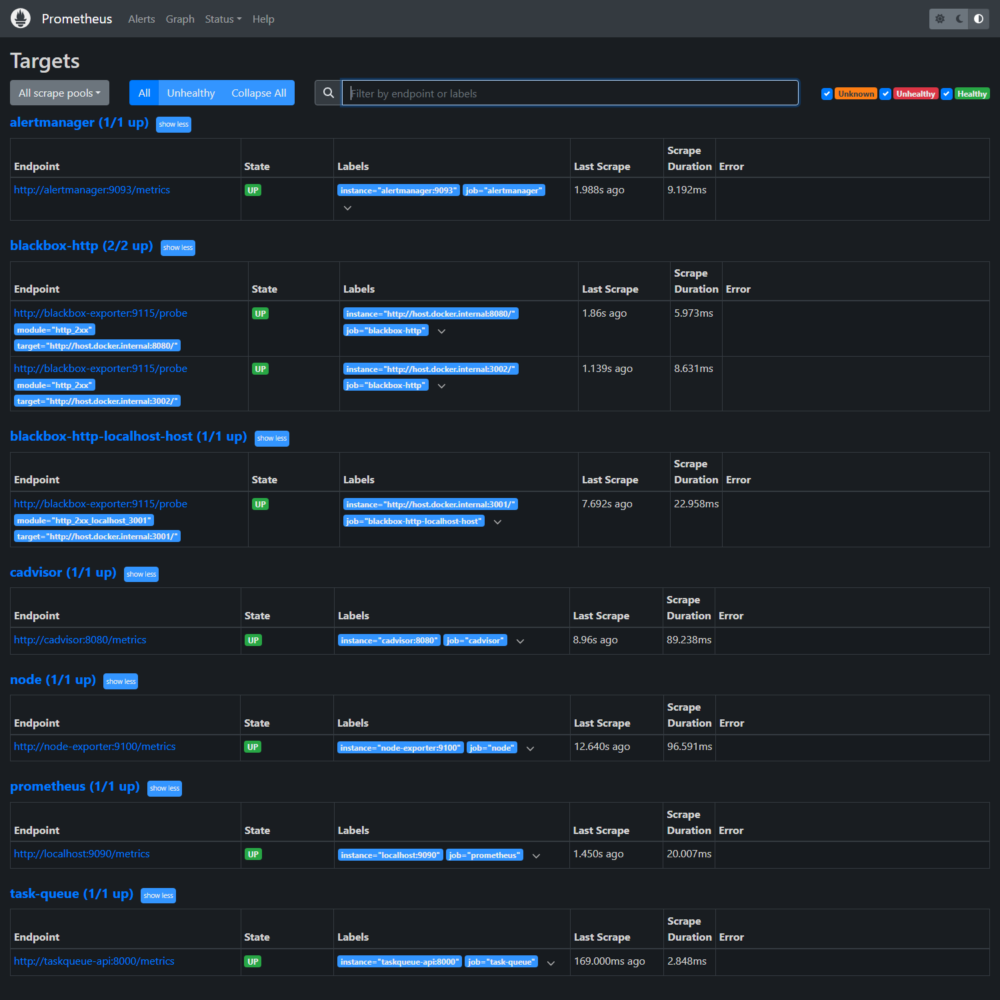
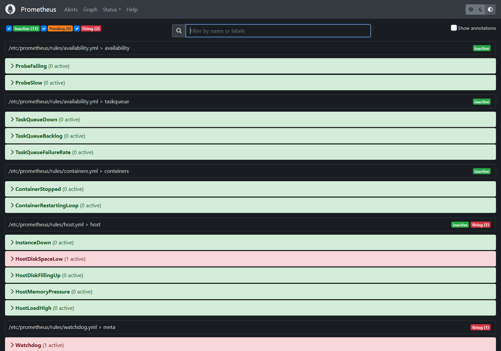
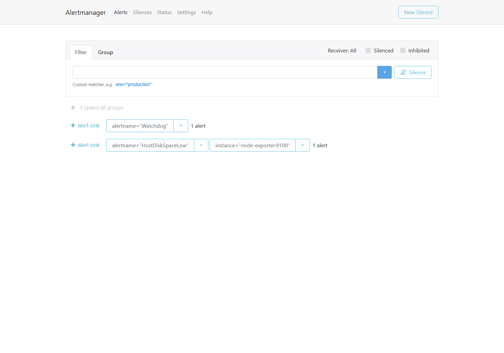

# Infrastructure monitoring and alerting

Prometheus, Grafana, Alertmanager and exporters for a self-hosted Linux server
and the containers on it. Deployed and running: eight scrape targets (all up),
five rule groups, three provisioned dashboards, and alerts delivered to
`alert-sink`, which records every notification and forwards it to Discord.

This is project 2 of a three-project portfolio; the first is
[distributed-task-queue](../distributed-task-queue), which exposes the
application metrics these rules watch for.

## What it does

| Area | Implementation |
| --- | --- |
| Host metrics | `node_exporter` — CPU, memory, filesystem, load, network, systemd units |
| Container metrics | `cAdvisor` — per-container CPU, memory working set, restart tracking |
| Service availability | `blackbox_exporter` HTTP probes of the services published on the host |
| Application metrics | `/metrics` on the task queue API (submission, claim, retry, completion counters, queue depth from the database) |
| Alerting | 13 rules across host, containers, availability, task queue and a deliberate Watchdog |
| Delivery | Alertmanager → webhook → `alert-sink`, which records every notification and posts it to a Discord webhook |
| Dashboards | Host overview, container overview, availability and alerts — provisioned from this repo, not clicked together |

## Layout

```
docker-compose.yml            seven services, memory-limited
prometheus/prometheus.yml     scrape config (add probe targets here)
prometheus/rules/*.yml        alert rules, versioned
alertmanager/alertmanager.yml routing and delivery
blackbox/blackbox.yml         probe modules
grafana/provisioning/         datasource + dashboard provider
grafana/dashboards/*.json     the three dashboards
alert-sink/                   tiny stdlib receiver, so delivery is provable
deploy.sh                     tar + ssh + docker compose up
docs/runbook.md               what each alert means and what to do about it
docs/screenshots/             the pages below, captured from the running stack
```

## Screenshots

All eight targets up, including the task queue deployed alongside this stack:



Five rule groups loaded; `HostDiskSpaceLow` firing on a real condition and the
deliberate `Watchdog` proving the pipeline:



Both alerts arriving at Alertmanager, grouped by receiver:



## Deploy

```bash
cp .env.example .env          # set GRAFANA_ADMIN_PASSWORD, DISCORD_WEBHOOK_URL
./deploy.sh                   # REMOTE=kota@server by default, target ~/monitoring
```

Or by hand:

```bash
ssh kota@server 'mkdir -p ~/monitoring'
tar czf - --exclude=.git --exclude=.env . | ssh kota@server 'tar xzf - -C ~/monitoring'
ssh kota@server 'cd ~/monitoring && printf "GRAFANA_ADMIN_PASSWORD=..." > .env && docker compose up -d --build'
```

Ports: Prometheus `9091`, Grafana `3003`, Alertmanager `9093`. Everything else is
internal to the compose network — exporters are not published.

## Verified on the server

Checked after deployment, not assumed:

```
8 scrape targets, 8 up (task-queue included once the API was deployed)
5 rule groups: host (5), containers (2), availability (2), taskqueue (3), meta (1)
probe_success = 1 for all three probed services
Grafana 11.3.0, dashboards: host-overview, containers-overview, availability
Watchdog firing continuously and present in alert-sink output (pipeline proven)
HostDiskSpaceLow firing for /mnt/media at 13.3% free
Discord delivery: hand-fired alert posted (posted=true, no error), and its
resolution posted as a second message
```

The task-queue rules are loaded and evaluating: `TaskQueueDown`,
`TaskQueueBacklog` and `TaskQueueFailureRate` are all inactive because the API is
answering `/metrics` in 3–8 ms.

The sink reports what it did with each notification, so delivery is checked
rather than inferred:

```json
{
  "status": "firing",
  "name": "DiscordVerify",
  "severity": "warning",
  "instance": "notification-test",
  "posted": true,
  "post_error": null
}
```

## Design decisions

- **Memory limits on every container.** The host runs a media stack; monitoring
  must not be the reason it falls over. Prometheus is capped at 512 MB, Grafana
  at 320 MB, cAdvisor at 192 MB.
- **The alert receiver is a container.** Without it, "alerts work" is unproven
  until something real breaks. `alert-sink` accepts the webhook and exposes what
  it received at `/alerts`, so delivery can be checked at any time.
- **A permanently firing Watchdog.** Silence is indistinguishable from a broken
  pipeline; a guaranteed alert every 24 hours proves the path end to end.
- **Probe halves are split by Host header.** Next.js answers `400` to a request
  whose Host is `host.docker.internal`, so that target uses a module with an
  explicit `Host: localhost:3001`. Verified by asking the container directly.
- **The task-queue scrape target is commented out**, not left failing. An
  always-firing `TaskQueueDown` would train you to ignore it. Uncomment it when
  the API is deployed on `host.docker.internal:8000`.
- **Alerts exclude each other's causes.** `InstanceDown` ignores probe jobs
  (`ProbeFailing` covers them) and the task queue (which has its own alert), so
  one dead endpoint does not page four times.

## Limitations

- Notifications go to Discord only. The sink supports one webhook; a second
  channel means running a second sink or adding the URL as a comma-separated
  list.
- The sink keeps the last 500 notifications in memory, so a restart clears the
  proof endpoint (the Discord channel keeps its own history).
- `TaskQueueFailureRate` needs traffic to mean anything: with an idle queue the
  denominator is zero and the rule stays inactive by design.
- Grafana dashboards are provisioned read-only (`allowUiUpdates: false`); edit
  the JSON in this repo rather than the UI.
